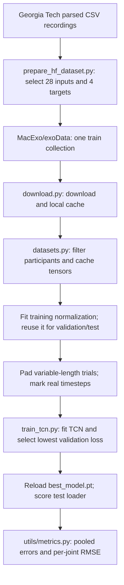

# 2025–26 dataset and evaluation review

**Owners:** Saharsh and Krishiv · **Issue:** [#19](https://github.com/macexo/exoskeleton-ml/issues/19)
**Review date:** November 12, 2026 · **Status:** Draft for pair review; lead review not requested.
**Code inspected:** `5747037e203c0e69e853f8f070ca7fcf10dfe5ea` (full revision in the run record). Links below pin the inspected files; no archived code was changed.

## Summary

The archived pipeline learns to predict four continuous biological joint moments—left/right hip flexion and knee moments—from movement recordings, using a temporal convolutional network (TCN). It loads a reduced Georgia Tech dataset, holds out participants, selects a checkpoint using validation loss, and reports regression metrics on the test participants. The historical result is documented, but its original run artifacts are unavailable; the current evaluation also differs enough from the paper that its headline numbers are not a like-for-like reproduction. [Preparation][prepare] · [Training and final test][train] · [Historical result][historical]

## Dataset overview

### Collection phases and participants

| Original collection | Participants relevant to the review | Conditions and purpose |
|---|---|---|
| Phase 1 | 10 analysed training participants: BT01, BT02, BT03, BT06–BT12 | Unpowered recordings across tasks, plus heuristic assistance where available |
| Phase 2 | BT13–BT17: five training participants | Preliminary learned controller provides assistance |
| Phase 3 | BT01, BT02, BT13 and BT18–BT24: ten validation participants | Final controller; returning users' earlier data excluded from their deployed model's training |

The release distinguishes **Phase1And2** from **Phase3**; the local name `phase1` covers IDs from both original training phases. The paper describes 28 task groups, 66 conditions and 15 training versus ten validation users; the overlap above means 22 unique analysed users, not 25 independent people. The original README also lists BT04's mass, while BT04 and BT05 are absent from our processed roster; their exclusion reasons are unresolved. [Original README: Overview and Subject mass][readme] · [Paper: Data availability][paper] · [Configured roster][data-config]

### Tasks and sensors

The task groups span cyclic movement (walking, running, slopes and stairs), impedance-like movement (squats, lunges, lifting and jumping), and unstructured movement (turning, meandering and perturbation recovery). File names are not task labels: for example, `normal_walk` includes walking, running and skipping conditions that belong to different groups. Use the original README's **Task groupings** mapping before producing per-task statistics. [Dataset task inventory][dataset-analysis] · [Original README: Task descriptions and Task groupings][readme]

The local analysis groups the 28 activities as follows; this is a task inventory, not an assertion of balanced trial counts. [Local movement list][dataset-analysis] · [Original task grouping definitions][readme]

| Category | Task groups |
|---|---|
| Cyclic | Level walking; loaded walking; backward walking; toe/heel walking; incline walking; decline walking; stair ascent; stair descent; running |
| Impedance-like | Standing poses; lunges; sit/stand; tug of war; medicine-ball toss; step up; jump across; jump in place; lift/place weight; squats |
| Unstructured | Start/stop; cutting; step over; turn; meander; twister; push/pull recovery; calisthenics; curb |

The original recording contains bilateral thigh, shank and foot IMUs, hip/knee encoders and pressure insoles. Motion capture and ground reaction forces support reference biomechanics; these are distinct from signals available on a wearable device. Joint angles and moments are OpenSim-derived, and biological moments subtract exoskeleton interaction torque from net moments. [Original README: File structure and File contents][readme] · [Supplement: Data Processing & Biomechanical Modeling, printed p. 3][supp]

### Sampling and filtering

- The released biomechanical signals use a **200 Hz time base**. Exoskeleton sensor recordings are upsampled from **55 Hz to 200 Hz**; interpolation does not create independent 200 Hz sensor measurements. [Original README: File structure][readme]
- The README specifies a **fifth-order, 6 Hz low-pass filter** for the supplied filtered joint angles and moments, and describes parsed filtered-angle data as zero-lag filtered. The local overview's generic “10 Hz” filter should not be substituted for these file-specific definitions. [Original README: File structure and File contents][readme] · [Local technical specifications][dataset-analysis]
- The local overview reports 200 Hz motion capture, 1,000 Hz force collection, and 120 Hz recordings for two early participants resampled to 200 Hz. Those acquisition details were not independently resolved from the accessible main-paper preview or supplement; treat them as locally documented, pending primary-method confirmation. [Local technical specifications][dataset-analysis]

### The subset actually used

The pinned Hugging Face revision `d3640796d9b8697153f36c9154ced1555cd9230d` contains **1,669 trial records**, **15 participants**, **9,369,823 timesteps** and sequence lengths of **216–43,201 timesteps**. The site publishes one split named `train`; that is the entire processed collection, not our experiment's final training set. Counts here were recomputed from the downloaded shards, not inferred from an old integration-test example. [Pinned dataset files][hf-files] · [Dataset inspection record][run-record]

| Selected component | Dimensions | Actual source |
|---|---:|---|
| Left/right thigh IMUs | 12 | `*_exo.csv`: three acceleration axes and three gyroscope axes per sensor |
| Left/right shank IMUs | 12 | Same exoskeleton file and axes |
| Left/right hip flexion and knee angles | 4 | `*_angle_filt.csv`: filtered OpenSim kinematics, **not encoder columns** |
| Total input | **28** | Concatenated IMU and angle values |
| Four biological moment targets | **4** | `*_moment_filt_bio.csv`, already **Nm/kg** |

The selected columns exclude **both foot IMUs**, **insole force/centre-of-pressure**, joint velocities and actuator torque signals. The code stores body mass as metadata but does not divide the target columns by mass, which is consistent with the README's already mass-normalized labels. The missing foot/insole signals and use of offline kinematics make this an adaptation of the dataset, not the original sensing setup. [Feature extraction and metadata][prepare] · [Feature names][data-config] · [Original column units and definitions][readme]

### Default split

| Split | Participant IDs | People | Trials | Timesteps |
|---|---|---:|---:|---:|
| Train | BT01, BT02, BT03, BT06, BT07, BT08, BT09, BT10, BT11, BT12, BT13 | 11 | 1,375 | 7,536,065 |
| Validation | BT14 | 1 | 73 | 466,355 |
| Test | BT15, BT16, BT17 | 3 | 221 | 1,367,403 |

These are participant-disjoint groups, approximately 73%/7%/20% **by people**, not by trials. The configuration comment calls the split “Leave-One-Subject-Out,” but `train_tcn.py` executes this one fixed split: it does not rotate the held-out subject through folds. All validation/test users are Phase 2 participants, whereas ten of the eleven training users are from Phase 1, so person and collection/controller differences are partly intertwined. [Split configuration][data-config] · [Loader construction][loaders] · [Recomputed counts][run-record] · [Phase definitions][readme]

No task holdout is implemented by the main training path. Thus its test estimates transfer to new people within the available task collection, not transfer to unseen tasks. By contrast, the paper's final model used 19 tasks and evaluated nine withheld tasks, with a further eight-task novelty experiment. [Main loader call][train] · [Supplement: Novel Task Analysis, printed p. 1][supp]

## How it works

### Files and sequence of operations

Each step is supported by the [preparation script][prepare], [download utility][download], [dataset implementation][datasets], [training entry point][train] and [active metric implementation][metrics]. The diagram describes the implemented flow; it does not establish that every configuration switch is connected.

| Stage / file | What the implementation does |
|---|---|
| `scripts/prepare_hf_dataset.py` | Reads exo, filtered-angle and biological-moment files; rejects absent files/columns and unequal row counts; copies selected columns into nested lists. Equal lengths are checked, but timestamp equality is not. [Source][prepare] |
| `data/download.py` | Loads the Hub's `train` split, saves an Arrow cache and metadata, and reuses the cache. Integrity checking inspects schema and the first trial, not every record. [Source][download] |
| `data/datasets.py` | Filters by participant; concatenates inputs; caches tensors; computes per-channel statistics from training data and passes those statistics to validation/test. Replaces NaNs with zero on retrieval. [Source][datasets] · [Normalization sharing][loaders] |
| `datasets.py::collate_fn` | Pads to the batch's longest trial; its boolean mask represents sequence length, not original label validity. [Source][collate] |
| `scripts/train_tcn.py` | Adam optimization, masked squared-error loss, validation each epoch, scheduler/early stopping, best-checkpoint reload, then one final test evaluation. Saves `config.yaml` and `training_results.pt`. [Source][train] |
| `utils/metrics.py::RunningMetrics` | Accumulates error sums and target statistics without retaining all predictions; reports pooled RMSE, MAE, R², NRMSE and four per-joint RMSEs. This is the metric class imported by the trainer. [Source][metrics] · [Trainer import][train] |

### What the metrics mean

Let `y` be a reference value and `ŷ` the prediction. Here `N` counts scalar output values retained by the metric mask, pooling timesteps and four joints. [Metric implementation][metrics]

| Metric | Definition in this pipeline | Interpretation and limitation |
|---|---|---|
| RMSE | `sqrt(sum((ŷ − y)²) / N)` | Typical error magnitude with extra emphasis on large mistakes. Useful for large torque errors, but an average can conceal a short severe error. |
| MAE | `sum(abs(ŷ − y)) / N` | Average absolute error; easier to interpret alongside RMSE. Does not show the worst-case error. |
| R² | `1 − sum((ŷ − y)²) / sum((y − mean(y))²)` | Improvement over predicting the pooled target mean. 1 is perfect; values can be negative. It is **not percent accuracy** and is not squared Pearson correlation. |
| NRMSE | `RMSE / (max(y) − min(y))` | Dimensionless relative error. This code uses one global observed range; an extreme target can make it look smaller. It is not the paper's per-trial normalized MAE. |
| Per-joint RMSE | Same RMSE formula separately for hip L/R and knee L/R | Prevents one aggregate from hiding a poorly predicted joint. |

These definitions and edge-case behavior come from [RunningMetrics.compute][metrics]. For constant targets or no valid samples it returns zeros for some/all scores rather than reporting an undefined result; inspect counts before interpreting a zero as excellent performance. [Source][metrics]

**Are they appropriate?** They are useful measures of moment-estimation accuracy, but insufficient alone to demonstrate beneficial exoskeleton assistance. As a review recommendation, keep them and also inspect per-person/per-task errors, signed over/underestimation, timing and large-error traces. Online controller effects need separate evidence: the paper evaluates human outcomes in addition to estimator accuracy. This recommendation follows the information lost by our pooling and the broader evaluation described by the [paper][paper] and [supplement][supp]; no hardware outcome was measured here.

### Units and aggregation: why headline numbers can mislead

With default normalization, the loader applies `z = (y − training_mean) / (training_std + 1e−8)` to **targets as well as inputs**. The trainer evaluates predictions against those standardized targets, never reverses the transformation, yet prints “Nm/kg.” Its default RMSE/MAE are therefore standardized-scale errors, not physical Nm/kg. Restore each channel before calculating physical errors; a single overall conversion factor is generally insufficient because channels have different scales. [Dataset normalization][normalization] · [Test output][train]

The pooled R² also need not equal a physical-unit pooled R² after channel-specific scaling. A single channel's R² is invariant to applying the same affine transform to predictions and references; pooling differently transformed channels changes their relative weighting. Likewise, time pooling gives longer trials and people with more recordings more influence; it is not an equal-weight average of task or participant scores. These are mathematical consequences of the [implemented accumulation and formula][metrics].

### Historical results and paper comparison

| Result | Reported numbers | What is established |
|---|---|---|
| Last year's local optimization plan | RMSE **0.4316**, R² **0.7311**, MAE **0.3014**; hip/knee RMSE rounded to **0.44/0.42** | A documented historical result, described as best epoch 79 of 99. The author labels errors Nm/kg, but original config/checkpoint/log is unavailable for verification. [Source][historical] |
| Original Nature paper | Mean online **R² 0.83** | Published assisted evaluation. [Abstract][paper] |
| Supplement's cross-study summary | Hip **0.17 Nm/kg**, knee **0.14 Nm/kg** RMSE | Separate joint summaries, not one global all-joint 0.14 benchmark. [Comparison to Offline Moment Estimators, printed p. 6][supp] |
| New five-epoch run | Standardized RMSE **0.4986**, R² **0.6410**, MAE **0.3502**; best epoch **3** of five | Actual saved checkpoint/test outputs; see the [run record][run-record]. |

For the new checkpoint, an independent read-only pass reproduced every archived test metric exactly. After restoring physical units and excluding originally invalid labels, the diagnostic pooled RMSE is **0.2093 Nm/kg**, MAE **0.1474 Nm/kg** and R² **0.6824**, over **4,379,640** valid scalar references. These are different summaries of the **same checkpoint**, not a model improvement or a paper-matched evaluation. Training still included the archive's zero-filled labels. [Procedure and full results][run-record]

**Did we use the same evaluation method? No.** The comparison differs in the following material ways:

| Aspect | Archived pipeline | Original study |
|---|---|---|
| Test setting | Offline fixed 11/1/3 participant split within Phase1And2 | Online Phase3 collection; returning participants excluded from their model's training [README][readme] |
| Sensors / kinematics | Four IMUs and four offline filtered OpenSim angles [Preparation][prepare] | Includes foot IMUs, encoders and insoles [Supplement: Statistical Analyses, printed pp. 5–6][supp] |
| Task generalization | No explicit held-out-task evaluation [Trainer][train] | 19 training tasks and nine withheld tasks [Supplement: Novel Task Analysis][supp] |
| Metric scale | Standardized labels by default, despite printed physical unit [Normalization][normalization] · [Trainer][train] | Body-mass-normalized reference moments [README][readme] |
| Summary weighting | Pooled time samples across joints; per-joint RMSE only [Metrics][metrics] | Per-task/joint and inter-subject summaries [Extended Data Fig. 4 caption][paper] |
| Timing | No evaluation-time delay alignment in `validate` [Trainer][train] | Estimates and references aligned for online estimator delay [Supplement: Statistical Analyses, printed p. 5][supp] |

The numerical R² difference is `0.83 − 0.7311 = 0.0989`, but it is descriptive arithmetic, not a controlled estimate of how much worse our architecture is. Do not divide 0.4316 by a published RMSE to claim a performance ratio while the historical scale/configuration remain unresolved. Sources for those values are the [historical plan][historical], [paper][paper] and [unit transformation][normalization].

## Advantages

- **Participant separation is explicit.** IDs are visible in one configuration, and the trainer passes the three lists to the loader. Worth keeping for understandable new-user evaluation. [Config][data-config] · [Trainer][train]
- **Training-only normalization is shared correctly.** Validation/test do not independently fit their own statistics. Keep this separation while making output units explicit. [Loader construction][loaders]
- **Variable-length batching has a real padding mask.** Padded values are excluded by the metric accumulator instead of artificially increasing easy zero predictions. [Collation][collate] · [Metrics][metrics]
- **Validation selects the checkpoint before final testing.** The trainer reloads the lowest-validation-loss checkpoint, then evaluates test data. This is a useful separation to preserve. [Training/test sequence][train]
- **Streaming metrics and per-joint errors are implemented.** The accumulator avoids holding every prediction in memory and provides more detail than one aggregate. [Metrics][metrics]
- **The dataset covers varied movements and assistance conditions.** Keep that breadth, with explicit task/condition accounting rather than assuming walking performance represents all movements. [Original task descriptions][readme] · [Local overview][dataset-analysis]

## Disadvantages

These are observations and review recommendations, **not code changes**.

| Finding | Evidence and consequence |
|---|---|
| **Physical-unit labels on standardized errors** | Targets are standardized, but evaluation never inverts them. Default reported RMSE/MAE cannot be interpreted as Nm/kg. Historical unit validity remains unresolved without its config. [Normalization][normalization] · [Trainer][train] |
| **Invalid reference moments become fabricated zero labels** | The original README intentionally marks invalid sensor-derived torques as NaN. `__getitem__` replaces them with zero; the sequence mask still marks those positions real. Both training and evaluation can then treat missing reference moments as genuine zero effort. [README: General notes][readme] · [Normalization][normalization] · [Collation][collate] |
| **Offline kinematics make deployment transfer unproven** | Inputs use filtered OpenSim angles rather than encoder readings; zero-lag filtering also uses future information during preprocessing. The causal TCN architecture does not make those inputs causal or available online. [Preparation][prepare] · [README][readme] · [TCN convolutions][tcn] |
| **Configuration promises more than the trainer connects** | `remove_invalid`, task filtering, normalization-method and cache-invalidation settings appear in YAML, but the main loader call does not pass them and the loader constructor has no corresponding arguments. Changing those switches alone does not implement the documented behavior. [Config][data-config] · [Trainer][train] · [Dataset constructor/cache key][datasets] |
| **Checkpoint selection weights batches, while metrics weight scalar values** | `validate` averages batch losses equally, but `RunningMetrics` pools all retained values. Variable trial lengths and the smaller final batch can make the two summaries disagree. [Validation loop][train] · [Metrics][metrics] |
| **Insufficient breakdown and uncertainty** | Final output is pooled plus per-joint RMSE; it does not report per-task/user R², confidence intervals or multiple-seed variation. One validation participant and three test participants provide limited evidence about population variability. [Metrics][metrics] · [Final evaluation][train] · [Split][data-config] |
| **Masking and invalid-result edge cases** | Loss computes squared errors before multiplying by a mask; a remaining NaN can survive because `NaN × 0` is NaN. Metrics exclude NaNs but not all infinities and return all-zero scores if no values remain. [Masked loss][train] · [Metrics][metrics] |
| **Cache identity is incomplete** | Preprocessed cache keys depend on participant IDs, not dataset revision/features. The downloader does not pin a Hub revision and returns an existing cache before a fresh integrity check. A changed data source can silently reuse old data. [Cache setup][datasets] · [Download/cache path][download] |
| **Reproducibility metadata is incomplete** | A `seed` exists in configuration, but the trainer never sets random seeds. It saves config/results and checkpoints, but the checkpoint does not bundle normalization statistics or dataset revision. [Config][main-config] · [Trainer][train] · [Checkpoint utility][checkpoint] |
| **Population and environment limits** | Local documentation describes able-bodied adults measured in a controlled laboratory. Those recordings alone do not establish performance for mobility impairments or uncontrolled use. [Local limitations][dataset-analysis] |
| **Documentation inconsistencies** | “LOSO” is a fixed split; local “Phase1” includes Phase2 IDs; local prose says “12 subjects” where the analysed first-phase roster has ten; model timing comments assume 100 Hz while the released data use 200 Hz. [Data config][data-config] · [Local analysis][dataset-analysis] · [Model config][model-config] · [README][readme] |

The downloaded-data audit makes the missing-label issue substantial rather than hypothetical: **19.08% of training target values, 19.29% of validation values and 19.93% of test values are non-finite before the loader's zero substitution**. These percentages count individual joint/timestep values, not whole recordings. The archived score therefore includes imputed targets in addition to valid biomechanical references. [Recomputed missingness and method][run-record] · [Zero substitution][normalization]

A further model-context inconsistency is worth recording: each block has **two** convolutions with the same dilation, while `effective_history` uses a one-convolution-per-level formula. For five blocks, kernel 7 and dilations 1,2,4,8,16, the maximum convolutional receptive field is `1 + 2 × (7−1) × (1+2+4+8+16) = 373` samples, not the metadata's 187. At 200 Hz that is about 1.865 s, rather than the 100 Hz timing explanation printed by the trainer. This is a calculation from the [convolution/block implementation][tcn] and [model configuration][model-config], not a changed model.

## Open questions

1. **Historical provenance:** Can a returning member locate the original 0.4316/0.7311 run's configuration, checkpoint, normalization statistics and log? Krishiv reports that he does not have them; the documentation alone cannot establish its scale or exact split. [Historical claim][historical]
2. **Dataset exclusions:** Why are BT04 and BT05 absent from the processed roster, and which other raw trials were excluded before upload? The source README and preparation checks do not supply a complete exclusion manifest. [README][readme] · [Preparation][prepare] · [Downloaded inventory][run-record]
3. **Online feature contract:** Will this year's model use encoder angles, estimated biological angles, or another representation? How will units, sign conventions and filtering match training? The raw exoskeleton and OpenSim conventions differ. [README: General notes and column definitions][readme] · [Selected columns][prepare]
4. **Missing-label policy:** Should invalid moments be excluded per channel/timestep, rather than zero-filled? Which trial activity flags should apply to scoring? Those validity flags are not retained in the processed schema. [README][readme] · [Preparation schema][prepare] · [Loader behavior][normalization]
5. **Comparison target:** Is the objective reproducing last year's offline implementation or reproducing the published online protocol? The participant phases, task holdout and sensors differ, so these require separate result tables. [Trainer][train] · [Original protocol][readme] · [Supplement][supp]
6. **Exact published R² definition:** Our formula is verified in code, but the authors’ scoring implementation was not accessible through Code Ocean during this review. Confirm whether their R² is the identical residual-based definition or a fitted/correlation statistic before treating the values as interchangeable. [Our formula][metrics] · [Authors’ code](https://doi.org/10.24433/CO.7641031.v2)
7. **Acquisition details:** Can the full paper Methods confirm the local claims about early 120 Hz recordings and original force/motion-capture acquisition rates? The verified release time base is 200 Hz. [Local notes][dataset-analysis] · [README][readme]
8. **Human review:** Krishiv and Saharsh must both review this draft and the new run record before a lead review is requested. The November 12 update and November 19 presentation remain human meeting actions; preparing this report does not mark either as delivered. [Issue acceptance criteria](https://github.com/macexo/exoskeleton-ml/issues/19)

## Sources and reproducibility

Code links below pin the reviewed source version. Dataset revision, downloaded-shard hashes, exact run overrides and test results are recorded separately in the [run record][run-record]. Historical documentation, new measurements and published results are kept distinct throughout.

[paper]: https://www.nature.com/articles/s41586-024-08157-7
[supp]: https://static-content.springer.com/esm/art%3A10.1038%2Fs41586-024-08157-7/MediaObjects/41586_2024_8157_MOESM1_ESM.pdf
[readme]: https://repository.gatech.edu/bitstreams/68b2d62a-d61a-4687-bcb3-475d3c1e5a73/download
[hf-files]: https://huggingface.co/datasets/MacExo/exoData/tree/d3640796d9b8697153f36c9154ced1555cd9230d
[run-record]: dataset-evaluation-run.md
[prepare]: https://github.com/macexo/exoskeleton-ml/blob/5747037e203c0e69e853f8f070ca7fcf10dfe5ea/archive/2025-26/scripts/prepare_hf_dataset.py#L24-L188
[train]: https://github.com/macexo/exoskeleton-ml/blob/5747037e203c0e69e853f8f070ca7fcf10dfe5ea/archive/2025-26/scripts/train_tcn.py#L18-L400
[historical]: https://github.com/macexo/exoskeleton-ml/blob/5747037e203c0e69e853f8f070ca7fcf10dfe5ea/archive/2025-26/docs/optimization_plan.md#L1-L379
[data-config]: https://github.com/macexo/exoskeleton-ml/blob/5747037e203c0e69e853f8f070ca7fcf10dfe5ea/archive/2025-26/configs/data/phase1.yaml#L1-L154
[dataset-analysis]: https://github.com/macexo/exoskeleton-ml/blob/5747037e203c0e69e853f8f070ca7fcf10dfe5ea/archive/2025-26/docs/georgia_dataset_analysis.md#L12-L188
[loaders]: https://github.com/macexo/exoskeleton-ml/blob/5747037e203c0e69e853f8f070ca7fcf10dfe5ea/archive/2025-26/src/exoskeleton_ml/data/datasets.py#L456-L488
[download]: https://github.com/macexo/exoskeleton-ml/blob/5747037e203c0e69e853f8f070ca7fcf10dfe5ea/archive/2025-26/src/exoskeleton_ml/data/download.py#L45-L204
[datasets]: https://github.com/macexo/exoskeleton-ml/blob/5747037e203c0e69e853f8f070ca7fcf10dfe5ea/archive/2025-26/src/exoskeleton_ml/data/datasets.py#L47-L193
[normalization]: https://github.com/macexo/exoskeleton-ml/blob/5747037e203c0e69e853f8f070ca7fcf10dfe5ea/archive/2025-26/src/exoskeleton_ml/data/datasets.py#L295-L313
[collate]: https://github.com/macexo/exoskeleton-ml/blob/5747037e203c0e69e853f8f070ca7fcf10dfe5ea/archive/2025-26/src/exoskeleton_ml/data/datasets.py#L315-L371
[metrics]: https://github.com/macexo/exoskeleton-ml/blob/5747037e203c0e69e853f8f070ca7fcf10dfe5ea/archive/2025-26/src/exoskeleton_ml/utils/metrics.py#L12-L129
[tcn]: https://github.com/macexo/exoskeleton-ml/blob/5747037e203c0e69e853f8f070ca7fcf10dfe5ea/archive/2025-26/src/exoskeleton_ml/models/tcn.py#L47-L243
[main-config]: https://github.com/macexo/exoskeleton-ml/blob/5747037e203c0e69e853f8f070ca7fcf10dfe5ea/archive/2025-26/configs/config.yaml#L1-L52
[checkpoint]: https://github.com/macexo/exoskeleton-ml/blob/5747037e203c0e69e853f8f070ca7fcf10dfe5ea/archive/2025-26/src/exoskeleton_ml/utils/checkpointing.py#L10-L52
[model-config]: https://github.com/macexo/exoskeleton-ml/blob/5747037e203c0e69e853f8f070ca7fcf10dfe5ea/archive/2025-26/configs/model/tcn.yaml#L1-L39
